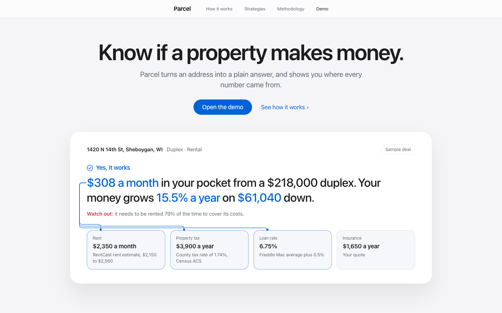
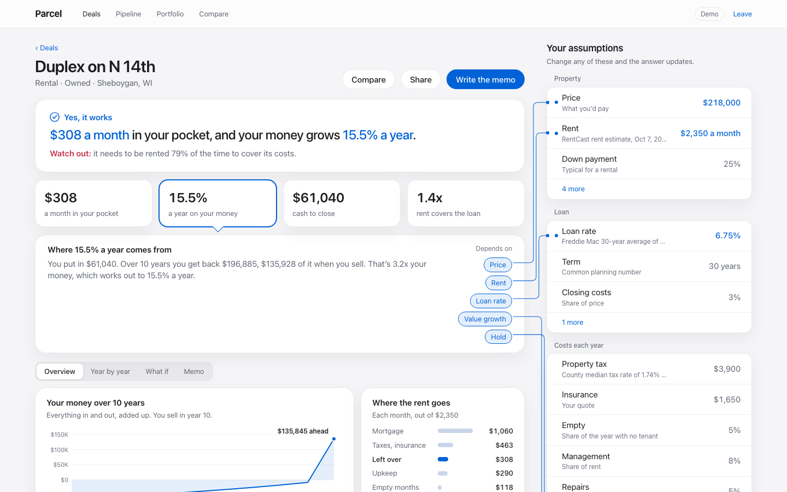
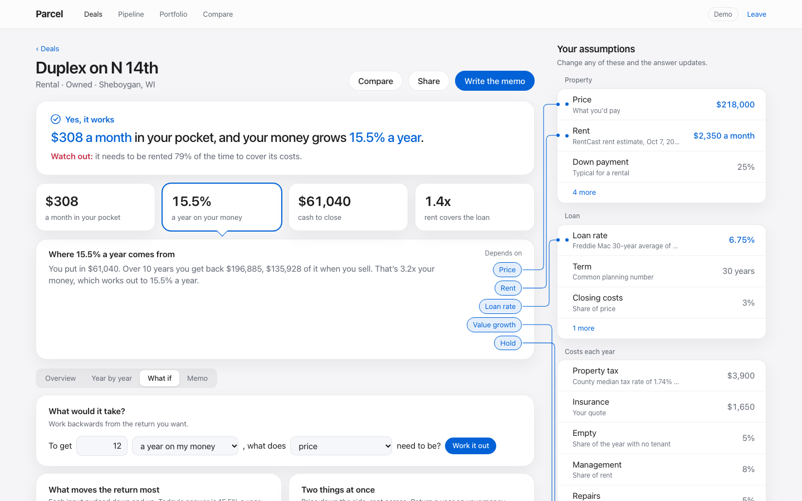

# Parcel

Know if a property makes money.

Parcel turns an address into a plain answer. Paste the address, say what you would do with it (rent it, flip it, BRRRR it, wholesale it, or take over the seller's loan), and it tells you in a sentence whether the deal works, what it depends on, and what would break it. Every number can be traced back to where it came from.



## What it does

- **One model for five strategies.** A deal is a month by month cash flow ledger. Rental, BRRRR, flip, wholesale and creative finance are presets on top of it, so they report the same numbers and compare fairly.
- **Plain answers first.** "$308 a month in your pocket, and your money grows 15.5% a year." Tap any number and it explains itself and lights up the inputs it depends on. IRR, DSCR and cap rate are there, one tap deeper.
- **Every input has a source.** Rent and value from RentCast, taxes from the Census, the loan rate from Freddie Mac, or a labeled estimate. Parcel never fills a cost with zero because it doesn't know it.
- **What if.** Work backwards from the return you want. See what moves the return most. Run ten thousand versions of the deal and find out how often it loses money.
- **A memo that can't make things up.** A one page summary is written by a language model, then every figure in it is checked against the engine before you see it.
- **Pipeline, portfolio, compare, share.** Move deals through stages, record what actually came in against the plan, read up to four deals side by side, and share a report anyone can open and print.





## How it's built

```
api/   FastAPI, SQLAlchemy async, Postgres with row level security
       engine/  pure Python and numpy: the ledger, metrics, solvers, sensitivity, Monte Carlo
web/   React 19, Vite, TanStack Router and Query, a client typed from the API's OpenAPI schema
docs/  decision records and the screenshots above
```

A few choices worth knowing about, each written up in [docs/decisions](docs/decisions):

- The engine is pure and vectorized. One analysis takes about 0.3 ms; a ten thousand run simulation about 150 ms.
- Reverse solving ("what price gives me 12%?") is root finding on the forward model, so the two can never disagree.
- Postgres does everything: provider caches, usage limits, demo sandboxes. No Redis, no worker.
- Tenant isolation is enforced by the database with forced row level security, and proven by tests.
- The browser computes nothing financial. It asks the API, which answers in a few milliseconds, and turns the figures into words.
- The design follows Apple's Human Interface Guidelines: system font, one accent color, light and dark following the device, no component library.

## Running it

You need Python 3.13 with [uv](https://docs.astral.sh/uv/), Node 24 with pnpm, and Docker for Postgres.

```sh
make db                      # Postgres on port 5433
cp api/.env.example api/.env # ENVIRONMENT=development is enough to start
make dev                     # migrations, then the API on :8000
make web                     # the app on :5173, proxying /v1 to the API
```

Open http://localhost:5173 and click "Open the demo". The demo uses recorded figures for a few Sheboygan, WI addresses, so it never spends API calls. Real lookups need keys in `api/.env` (RentCast, Geoapify, FRED, HUD); accounts need a Clerk instance; the memo needs an Anthropic key; billing needs Stripe test keys. Each is optional and the app says plainly when a feature is off.

## Testing

```sh
make check          # ruff, mypy strict, pytest against Postgres with a 95% coverage floor
cd web && pnpm lint && pnpm typecheck && pnpm test   # ESLint strict, tsc, vitest
cd web && pnpm e2e  # Playwright through the demo, with axe accessibility checks (API must be running)
k6 run api/loadtest/analyze.js   # the workspace's paths under load
```

The engine's tests check every formula on the [methodology page](web/src/features/methodology/methodology.tsx) against worked examples, and property tests confirm that solving backwards then forwards lands where it started. An offline set of twenty deals exercises the memo check.

## Numbers

Measured on 2026-10-09 on a laptop, API running two workers, 20 virtual users for 30 seconds:

| Request | p50 | p95 |
|---|---|---|
| Recalculate a deal (`POST /v1/analyze`, monthly ledger) | 8 ms | 15 ms |
| List deals with their summaries | 12 ms | 25 ms |
| Sensitivity (tornado and grid) | 24 ms | 54 ms |

192 requests a second with no failures. The web app's main bundle is 92 KB gzipped; the public pages are prerendered.

## License

MIT.
